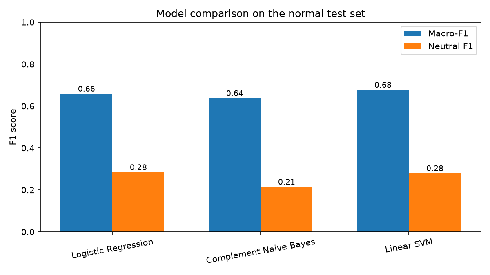
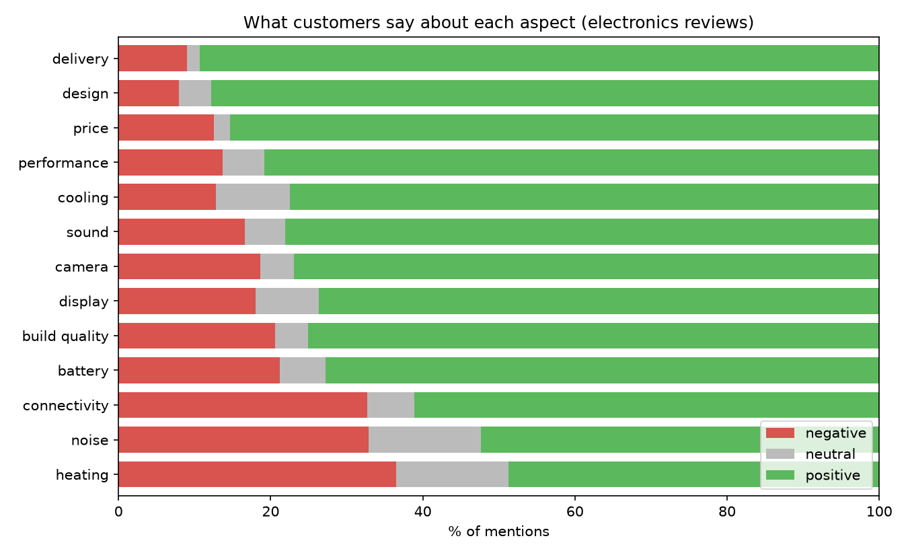

# ReviewLens

**Sentiment and aspect analysis of Flipkart electronics product reviews**


ReviewLens reads a customer review and predicts whether it is **positive, neutral or negative**, and it finds **what** customers are talking about (battery, camera, price, delivery, ...). It is trained on more than 67,000 Flipkart electronics reviews, using the customer's star rating as the label.


## Table of contents

- [Why this project](#why-this-project)
- [Features](#features)
- [Results](#results)
- [Aspect analysis](#aspect-analysis)
- [Quick start](#quick-start)
- [How it works](#how-it-works)
- [Dataset](#dataset)
- [Design decisions](#design-decisions)
- [Project structure](#project-structure)
- [Limitations](#limitations)
- [Roadmap](#roadmap)
- [Tech stack](#tech-stack)
- [Acknowledgements](#acknowledgements)
- [Author](#author)

## Why this project

Online stores collect thousands of reviews per product. Reading them all is impossible, yet buyers and sellers want to know the overall mood and, more importantly, *what* people like or dislike. A single average rating hides this: "great camera but terrible battery" and "average everything" can both be 3 stars.

ReviewLens turns raw review text into two answers: **how do customers feel**, and **about which aspect**.

## Features

- **Sentiment classification** into positive, neutral and negative, comparing Logistic Regression, Complement Naive Bayes and a Linear SVM on TF-IDF features
- **Careful text cleaning** that keeps negations, so "not good" is never turned into "good"
- **Aspect-based analysis** for 13 electronics aspects (battery, camera, display, sound, performance, price, build quality, design, connectivity, delivery, heating, cooling, noise), scored per clause so mixed reviews are handled correctly
- **Honest evaluation**: macro-F1 instead of plain accuracy, a "strict" test set of unseen texts, and error analysis
- **Fully documented notebooks** that explain every step in plain language, plus a glossary of the ML terms used

## Results

All models use the same split (53,920 training reviews and 13,481 test reviews; the strict test set has 7,621) and the same features. Macro-F1 is the headline metric because about 78% of reviews are positive, so plain accuracy is misleading.

| Model | Test set | Accuracy | Macro-F1 | Negative F1 | Neutral F1 | Positive F1 |
|---|---|---|---|---|---|---|
| Logistic Regression | normal | 0.791 | 0.659 | 0.814 | 0.285 | 0.878 |
| Logistic Regression | strict | 0.801 | 0.660 | 0.787 | 0.301 | 0.891 |
| Complement Naive Bayes | normal | 0.861 | 0.638 | 0.767 | 0.215 | 0.932 |
| Complement Naive Bayes | strict | 0.829 | 0.617 | 0.739 | 0.199 | 0.914 |
| Linear SVM | normal | 0.875 | 0.678 | 0.815 | 0.280 | 0.939 |
| Linear SVM | strict | 0.844 | 0.654 | 0.782 | 0.258 | 0.923 |
| Linear SVM (tuned) | normal | 0.883 | 0.686 | 0.828 | 0.287 | 0.943 |
| Linear SVM (tuned) | strict | 0.861 | 0.674 | 0.805 | 0.288 | 0.930 |

A baseline that always predicts "positive" scores a macro-F1 of only 0.292.

**Key findings**

- The models range from 0.638 to 0.686 macro-F1, so the algorithm matters less than the data.
- Tuning the SVM's regularisation strength with cross-validation on the training data (best C = 0.1, versus the default 1.0) raised its strict-test macro-F1 from 0.654 to 0.674. The tuned SVM is the best model on both test sets, 1.4 to 2.7 points ahead of Logistic Regression.
- The SVM's lead on the normal test set partly comes from repeated generic phrases such as "good" and "nice"; the strict test set (texts never seen in training) gives the more honest comparison.
- Higher accuracy does not mean a better model: Naive Bayes beats Logistic Regression on accuracy but not on macro-F1.
- **Neutral is the hardest class for every model** (F1 about 0.2 to 0.3, including the tuned SVM). 3-star reviews are often worded politely, and identical text receives different star ratings from different people, so the limit comes mainly from label noise in the data.



## Aspect analysis

Each review is split into clauses, and the trained model scores every clause that mentions an aspect. 27,842 of the 67,401 reviews (41%) mention at least one aspect, giving 45,935 scored mentions.

| Aspect | Mentions | Negative % | Neutral % | Positive % | Net score |
|---|---|---|---|---|---|
| delivery | 3,635 | 9.0 | 1.7 | 89.3 | 80.3 |
| design | 3,888 | 7.9 | 4.3 | 87.7 | 79.8 |
| price | 10,221 | 12.5 | 2.2 | 85.3 | 72.8 |
| performance | 3,804 | 13.7 | 5.5 | 80.7 | 67.0 |
| cooling | 516 | 12.8 | 9.7 | 77.5 | 64.7 |
| sound | 6,789 | 16.6 | 5.3 | 78.0 | 61.4 |
| camera | 871 | 18.6 | 4.5 | 76.9 | 58.3 |
| display | 1,742 | 18.0 | 8.3 | 73.8 | 55.8 |
| build quality | 6,747 | 20.6 | 4.3 | 75.2 | 54.6 |
| battery | 2,890 | 21.2 | 6.0 | 72.8 | 51.6 |
| connectivity | 2,600 | 32.7 | 6.2 | 61.1 | 28.4 |
| noise | 781 | 32.9 | 14.7 | 52.4 | 19.5 |
| heating | 1,451 | 36.5 | 14.8 | 48.7 | 12.3 |

Net score = % positive minus % negative.

- Most aspect mentions are positive, in line with the 78% positive reviews overall. The useful comparison is with the overall negative rate of 14.7%.
- **Heating (36.5% negative), noise (32.9%) and connectivity (32.7%) are criticised more than twice as often as average.** Battery, build quality, camera and display are also above average.
- Delivery, design and price receive the least criticism.
- Cooling, camera and noise have fewer than 900 mentions each, so their percentages are less stable.



**Validation.** A manual check of 30 random aspect clauses found about 80% fully correct (aspect tag and sentiment). The errors exposed two keyword problems ("price range" tagged as connectivity, and the verb "delivers" tagged as delivery), which were fixed and the analysis re-run. Remaining weaknesses: run-on clauses with mixed sentiment, and occasional wrong keyword matches.

## Quick start

**Requirements:** Python 3.10 or newer (developed on 3.13) and Git.

```bash
# 1. Clone and enter the project
git clone https://github.com/<your-username>/reviewlens.git
cd reviewlens

# 2. Create and activate a virtual environment
python3 -m venv .venv
source .venv/bin/activate          # Windows: .venv\Scripts\activate

# 3. Install dependencies and NLTK data
pip install -r requirements.txt
python -m nltk.downloader stopwords wordnet
```

On macOS, if the NLTK download fails with an SSL certificate error, run `pip install certifi` and `export SSL_CERT_FILE=$(python -c "import certifi; print(certifi.where())")` first.

```bash
# 4. Get the data (see Dataset below) and save it as data/raw/Dataset-SA 2.csv

# 5. Run the notebooks in order
jupyter notebook
```

Open and run each notebook from top to bottom (Kernel, then Restart and Run All):

| # | Notebook | What it does |
|---|---|---|
| 1 | `01_data_preparation.ipynb` | Loads, checks and cleans the data, builds labels, filters electronics |
| 2 | `02_baseline_model.ipynb` | Train/test split, TF-IDF, Logistic Regression, evaluation, error analysis |
| 3 | `03_model_comparison.ipynb` | Compares three models and tunes the SVM |
| 4 | `04_aspect_sentiment.ipynb` | Finds aspects in reviews and scores sentiment per aspect |

Each notebook saves its output for the next one. Data files and trained models are not stored in the repository; they are regenerated by running the notebooks.

### Try the app

After running notebook 02 (which saves the model), start the web app:

```bash
streamlit run app/streamlit_app.py
```

Paste a review to see its overall sentiment with the model's confidence, and the sentiment of each aspect it mentions.

## How it works

```
 raw reviews (CSV)
      |
      v
 1. Prepare data       remove duplicates, build labels from star ratings,
      |                keep only electronics products
      v
 2. Clean the text     lowercase, remove noise, keep negations
      |
      v
 3. Text to numbers    TF-IDF on words and word pairs
      |
      v
 4. Train and compare  Logistic Regression, Naive Bayes, Linear SVM
      |
      v
 5. Evaluate           macro-F1, strict test set, confusion matrix, error analysis
      |
      v
 6. Aspect analysis    split reviews into clauses, match aspect keywords,
                       score each clause with the trained model
```

Example of the aspect step (`src/aspects.py`):

```python
from src.aspects import extract_aspect_clauses

extract_aspect_clauses("Camera is great but battery is bad")
# [('camera', 'camera is great'), ('battery', 'battery is bad')]
```

## Dataset

Flipkart product reviews from Kaggle (//www.kaggle.comhttps/datasets/niraliivaghani/flipkart-product-customer-reviews-dataset
 author: niraliivaghani), collected by scraping Flipkart.

| Column | Meaning |
|---|---|
| `product_name` | Product name |
| `product_price` | Price |
| `Rate` | Star rating, 1 to 5 |
| `Review` | Review title (not used as a feature) |
| `Summary` | Review text (model input) |
| `Sentiment` | Label created with VADER by the dataset author (not used for training) |

| Step | Reviews |
|---|---|
| Raw file | about 205,000 |
| After removing missing text and duplicates | about 170,600 |
| Electronics products only | about 67,400 |

Class balance of the electronics subset: about 78% positive, 15% negative and 7% neutral.

## Design decisions

| Decision | Reason |
|---|---|
| Labels come from **star ratings** (4-5 positive, 3 neutral, 1-2 negative) instead of the dataset's VADER column | VADER agreed with the stars on most reviews but on only about 22% of 3-star reviews; training on it would teach the model to imitate VADER |
| Use `Summary` as input and ignore `Review` | `Review` is a short title that often states the sentiment outright (label leakage) |
| Remove duplicate rows **before** splitting | Identical rows in train and test inflate scores |
| Build an **electronics filter** and validate it by hand | The raw data mixes many product categories and has no category column |
| **Keep negations** during cleaning | Standard stop-word lists delete "not", turning "not good" into "good" |
| Report **macro-F1** and add a **strict test set** | Accuracy rewards predicting the majority class; the strict set shows the model is not just memorising repeated texts |
| Tune hyperparameters with **cross-validation on training data only** | Keeps the test set untouched |

## Project structure

```
reviewlens/
├── README.md
├── requirements.txt
├── notebooks/
│   ├── 01_data_preparation.ipynb
│   ├── 02_baseline_model.ipynb
│   ├── 03_model_comparison.ipynb
│   └── 04_aspect_sentiment.ipynb
├── app/
│   └── streamlit_app.py         web app to try the model on any review
├── src/
│   ├── preprocess.py            text cleaning (keeps negations)
│   ├── electronics_filter.py    keyword rules to select electronics products
│   └── aspects.py               clause splitting and aspect detection
├── docs/
│   └── GLOSSARY.md              ML terms used, in plain English
├── reports/                     charts and result tables
├── data/                        raw and processed data (not tracked by Git)
└── models/                      saved models (not tracked by Git)
```

## Limitations

- Star ratings are an imperfect stand-in for true sentiment, especially for 3-star reviews.
- The electronics filter uses keywords, so a few non-electronics products remain and a few electronics products are missed.
- Aspect detection is keyword-based: it only finds aspects whose words are listed, and most reviews are general comments that mention no aspect.
- The sentiment model is trained on whole reviews and applied to short clauses, which is less accurate than training on aspect-labelled data.
- Cleaning removes emojis and non-English text; Hinglish reviews are not handled specially.

## Roadmap

- [x] Data preparation, labelling and electronics filter
- [x] Text preprocessing that keeps negations
- [x] Baseline model and evaluation
- [x] Model comparison (Logistic Regression, Naive Bayes, Linear SVM)
- [x] Aspect-based sentiment analysis
- [ ] Improve the neutral class
- [ ] Transformer model (DistilBERT) and comparison
- [x] Streamlit app: paste a review and see its sentiment and aspects
- [ ] Repeat the pipeline on food and agriculture products

## Tech stack

Python, pandas, NumPy, scikit-learn, NLTK, matplotlib, seaborn, Streamlit, Jupyter.

## Acknowledgements

- Dataset: //www.kaggle.comhttps/datasets/niraliivaghani/flipkart-product-customer-reviews-dataset(author: niraliivaghani).